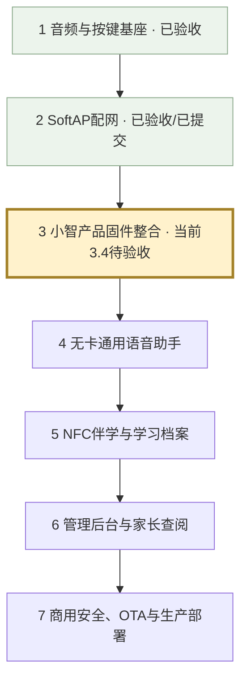

# stubuddy 开发全景与当前位置

当前日期：2026-11-02。当前检查点：3.4，小智主工程迁移SoftAP配网与网络录放门禁，待真机验收；3.3已提交e8ec267。
配网阶段已验收并提交为b22dc91；硬件音频基线为6f2b3ba。
这里的大阶段用于看全景；每个大阶段继续拆成小检查点，每次只实现一个可独立验收的特性。

| 大阶段 | 目标与分步验收 | 状态 |
| --- | --- | --- |
| 1 音频/按键/LED | 扬声器提示音、PDM录音回放、PTT消抖、60秒自动回放、待机灯灭/录放常亮 | 用户实测通过，已提交 |
| 2 SoftAP配网 | 开放热点、手机配网页、历史列表、配置保存、正常开机重连、人工配网等待、呼吸/错误灯效 | 用户实测通过，已提交b22dc91 |
| 3 产品固件与私有WS | 先在小智主工程建立专用板型并验证一次提示音，再逐项迁移交互、配网、Opus、私有WS | 3.1～3.3已验收并提交；当前3.4配网录放待真机验收 |
| 4 无卡通用助手 | 先PTT完整ASR→LLM→TTS，再端云VAD/全双工打断；分别验收音量工具、独立闹钟音量和定时提醒 | 未开始 |
| 5 NFC伴学 | 先读卡/防抖/移除回无卡模式，再技能模板/音频自动交麦/RAG/关卡激励；最后一卡一档与通关即存 | 未开始 |
| 6 中台与家长端 | 逐项验收技能与卡片编排、模型安全参数热更、设备账户/激活、家长学习记录与每日03:00归档 | 未开始 |
| 7 商用发布 | 分别实现设备鉴权/签名/限流、OTA校验与回滚、WS网关扩展/监控/故障恢复、生产压测 | 未开始 |

## 当前做到哪里

- 独立speaker-selftest的音频、按键、灯光和SoftAP已由用户验收，已提交b22dc91。
- 3.1已在小智主工程创建stubuddy专用板型，三次上电验收通过，已提交dac5504。
- 3.2全部按键流程与连续10轮真机验收通过，结束无杂音，已提交e6e553c。
- 3.3灯效、60秒自动回放、松键保护及连续10轮验收通过，结束无杂音，已提交e8ec267。
- 3.4新增wifi-ptt变体，迁移已验收的免密码热点、极简门户、五条成功历史与原NVS格式；强制配网在提示音前锁定，等待用户真机验收。
- 3.4.1补验：门户就绪后放行DHCP、首次探测302跳转、页面等待进度、成功3秒关闭热点、失败下降三音并保留错误提示。
- 3.4.1配网修复已由用户验收；3.4.2待补验：回放中按下打断并接续按住收音，满60秒确认PWM灭灯并保留150ms交接后自动回放。当前阶段尚未Git提交。
- 网络等待暂停新录音，已开始的一轮完整结束；恢复后必须先松键再重新按下。网络提示音由同一音频任务串行播放。
- 配网呼吸灯和错误闪烁在3.4实测；模型等待灯效接入模型时再测。
- ASR/模型/TTS云端对话、全双工、MCP、NFC、CMS、OTA和商用部署仍在后续阶段。

## 当前下一步

1. 按 [3.4.2补验说明](../../../xiaozhi-esp32-main/xiaozhi-esp32-main/main/boards/stubuddy-s3-n16r8/PTT-INTERRUPT-VALIDATION.md) 编译烧录，验证按键打断接续收音和60秒灭灯交接，回归已验收配网流程。
2. 连续10轮录放/打断通过，确认音质、首字、静音收尾和断网门禁后建立3.4 Git检查点。
3. 再讨论并确认3.5 Opus编解码的功能流程，确认后实现。

## 第3阶段小检查点

| 检查点 | 内容 | 验收 |
| --- | --- | --- |
| 3.1 | 专用板型、启动、一次提示音 | 三次上电均清楚且安静结束 |
| 3.2 | 迁移PDM采集与PTT录放 | 消抖、松开回放、60秒自动回放 |
| 3.3 | 迁移状态LED | 待机灭灯、录放常亮、等待/错误优先级 |
| 3.4 | 迁移已验收SoftAP | 首次确认、历史重连、人工配网保持等待 |
| 3.5 | Opus编解码 | 编解码回放清楚，资源稳定 |
| 3.6 | 私有WS回声通道 | 音频上下行和断线恢复正常 |

正式AI播报阶段必须验收：按下取消旧回复并清除端侧音频队列、继续按住收音/松开发送，以及回合标识过滤云端晚到的旧音频。

每个检查点都按讨论→确认→实现→给命令→用户实测→Git提交执行。
生产并发、延迟、可用性和成本目标在部署前结合服务器规格确定，不在未压测时宣称商用达标。
