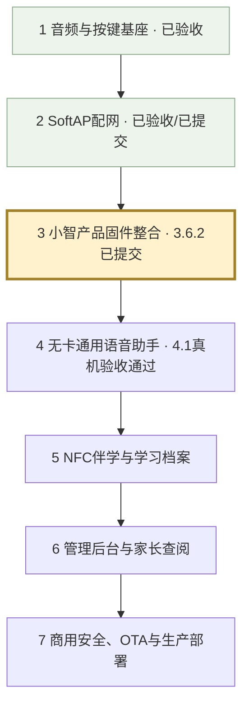

2026-11-06：经用户确认修复三个服务端问题（真实时钟播报、事项查询问法、识别错字结合提醒上下文澄清）。114项软件检查通过；PTT/八轮历史、固件/协议/NVS不变；等待云端/真机复验，不提交、不跨下一阶段。

4.3.2口语修复：功能介绍、创建/查询/取消分流、缺钟点追问及单个5分钟草稿、编号真实取消、提醒继续刷新、有限HTTP5xx重试和分段计时。106项服务端软件检查通过；固件与NVS未改，无需重烧。本轮待云端/真机复验，未提交，不进入下一阶段。详情见`stubuddy/server/voice-ai/REMINDERS.md`。

当前4.3.2实施范围：一个倒计时＋三个一次性/按周指定星期定时计划，五分钟间隔、统一事项列表与剩余时间区分、三分钟循环、重复计划停止本次保留下次。工作日类型删除。保留PTT/八轮历史；本轮尚待用户真机验收。完整流程见`stubuddy/server/voice-ai/REMINDERS.md`。

# stubuddy 开发全景与当前位置

2026-11-05验收更新：用户确认单个倒计时本轮四项修复及其他真机测试正常，当前只建立Git检查点。保留一个已知问题供下一轮讨论、修复和验证：“我有哪些提醒或倒计时”应准确报出设备保存的提醒事项；“还剩多久”才查询剩余时间。计划覆盖取消、重启恢复和新旧事项隔离，不在本轮增加业务代码，不进入定时提醒。详见[倒计时验收结论](../../server/voice-ai/COUNTDOWN.md)。

2026-11-05当前：4.2已验收并提交`f3b1f01`。用户确认4.3.1只做一个活动倒计时（1分钟～24小时），到点优先取消录音/旧播报，不排队、不续播；拟人化循环提醒（每轮间隔3秒、最多60秒）后删除，新按键停止并删除，断电/断网过期不补报。独立提醒音量默认50并保存，保留PTT与最近8轮生成即保存问答。尚待用户云端部署和真机验收，通过提交后再讨论定时提醒；操作见[倒计时手册](../../server/voice-ai/COUNTDOWN.md)。下方“待提交/播完才入历史”等是旧阶段记录，以此段及实际Git为准。

最新检查点结论（2026-11-05）：用户确认4.2合并真机验收全部通过。音量短句、50和60读音、收尾按键、打断记忆及60秒保护正常，连续20轮无误超时；软件84项测试与WSS回声/4.1/4.2构建核对通过。当前仅整理并由用户提交本轮Git，HEAD仍为4.1的`4b41025`，提交后以实际日志为准。按用户要求不进入下一阶段，下文“待复验”属于历史过程记录。

2026-11-05当前4.2修复：用户确认音量短句上下文、TTS中文数字/原始WAV对照、并发计时误判与错误细分。保留70%输出峰值、收尾按键和最近8轮生成即保存历史；完成软件检查后合并真机验收，尚未Git提交。操作见[4.2手册](../../server/voice-ai/PTT-CONTROLS.md)。

2026-11-05最新：用户明确将主工程AI语音/录音回放及开机、联网、错误音统一提升到70%数字峰值（±22937），由单一板级常量控制归一化/钳位/提示音和LED参考。与收尾按键和生成即提交8轮记忆合并复验；独立早期诊断工程保持原基线，未Git提交，不进入新阶段。操作见[4.2手册](../../server/voice-ai/PTT-CONTROLS.md)。

2026-11-04最新4.2修正：用户要求修复AI收尾瞬间按键丢失，并将记忆改为完整回答生成即保存，播报打断也保留完整文字。保持最近8轮已生成问答加当前输入；尚未生成就取消的请求不计轮数。已增加收尾消抖接续和取消/迟到结果/十轮窗口测试；等待本次编译及真机复验，不进入下一阶段。下文早期“播完才提交”属于旧验收规则，已被本次明确要求替代。

4.2修复进度：用户首轮真机确认LED律动及音量重启保存正常，发现首次发送超时后恢复、数学追问误走音量控制和静音恢复缺失。继续在4.2内修复：普通问答关闭工具入口，保留8轮历史；当前值/静音前非零值用单一NVS状态保存，新增恢复能力；WSS写等待有界放宽并补诊断。补丁软件检查后重新云端/真机验收，未Git提交，不进入新阶段。

当前工作更新（2026-11-04）：4.1已真机验收并提交`4b41025`，工作区干净后进入经用户确认的4.2：仅PTT，合并语音音量查询/调节、掉电保存与AI播报LED律动。4.2独立变体`ai-ptt-controls`的软件检查完成后交用户部署/烧录及真机验收，通过后再Git提交。VAD、连续听音和全双工暂停排期。4.3定时提醒/独立闹钟音量另行讨论确认，不在本次实现。4.2操作见[手册](../../server/voice-ai/PTT-CONTROLS.md)。下文保留4.1及更早阶段记录。

当前日期：2026-11-04。3.6.2已真机验收并提交6176ac9。当前检查点4.1：合并PTT ASR/LLM/TTS，统一阿里DashScope，完成流式TTS和独立下行容量修复，保留原交互及8轮完整历史加当前问题。新版云端两项自测、编译、烧录和真机验收均通过；用户反馈首声明显缩短，按键打断、60秒和连续十轮正常。Git状态以实际日志为准，按用户要求停在本检查点，不进入下一阶段。3.6.1已通过用户真机验收并提交5df51a4。
配网阶段已验收并提交为b22dc91；硬件音频基线为6f2b3ba。
这里的大阶段用于看全景；每个大阶段继续拆成小检查点，每次只实现一个可独立验收的特性。

| 大阶段 | 目标与分步验收 | 状态 |
| --- | --- | --- |
| 1 音频/按键/LED | 扬声器提示音、PDM录音回放、PTT消抖、60秒自动回放、待机灯灭/录放常亮 | 用户实测通过，已提交 |
| 2 SoftAP配网 | 开放热点、手机配网页、历史列表、配置保存、正常开机重连、人工配网等待、呼吸/错误灯效 | 用户实测通过，已提交b22dc91 |
| 3 产品固件与私有WS | 先在小智主工程建立专用板型并验证一次提示音，再逐项迁移交互、配网、Opus、私有WS | 3.1～3.6.2已验收；最新6176ac9 |
| 4 无卡通用助手 | 合并PTT完整ASR→LLM→流式TTS及8轮历史窗口；后续功能另行确认 | 4.1云端自测、编译/烧录和真机验收通过；停在本检查点 |
| 5 NFC伴学 | 先读卡/防抖/移除回无卡模式，再技能模板/音频自动交麦/RAG/关卡激励；最后一卡一档与通关即存 | 未开始 |
| 6 中台与家长端 | 逐项验收技能与卡片编排、模型安全参数热更、设备账户/激活、家长学习记录与每日03:00归档 | 未开始 |
| 7 商用发布 | 分别实现设备鉴权/签名/限流、OTA校验与回滚、WS网关扩展/监控/故障恢复、生产压测 | 未开始 |

## 当前做到哪里

- 独立speaker-selftest的音频、按键、灯光和SoftAP已由用户验收，已提交b22dc91。
- 3.1已在小智主工程创建stubuddy专用板型，三次上电验收通过，已提交dac5504。
- 3.2全部按键流程与连续10轮真机验收通过，结束无杂音，已提交e6e553c。
- 3.3灯效、60秒自动回放、松键保护及连续10轮验收通过，结束无杂音，已提交e8ec267。
- 3.4新增wifi-ptt变体，迁移免密码热点、极简门户、五条成功历史与原NVS格式；强制配网在提示音前锁定，用户真机验收通过。
- 3.4.1补验：门户就绪后放行DHCP、首次探测302跳转、页面等待进度、成功3秒关闭热点、失败下降三音并保留错误提示。
- 3.4.1配网与3.4.2按键打断/接续录音、首字、60秒灭灯交接和连续十轮录放均已真机验收通过，无杂音，已提交f5675ba。
- 3.5新增wifi-opus-ptt独立变体：边录音边按60ms编码，停止后补齐末帧/编解码延迟，解码后按真实采样数回放；保留3.4 PCM基线供回退。2026-11-03用户确认Opus自检、录放首尾、采样数一致、errors=0、60秒自动回放、按键打断、配网/断网恢复及连续十轮均通过，结束无杂音。
- 网络等待暂停新录音，已开始的一轮完整结束；恢复后必须先松键再重新按下。网络提示音由同一音频任务串行播放。
- 3.5已提交a49b3ff。3.6.1新增ws-echo固件与Windows轻量回声服务，实时逐帧上传，接收完整并校验后解码回放；等待/回放可取消并接续PTT。服务器内存暂存，结束或断线清理。
- 2026-11-03用户确认3.6.1真机验收通过：局域网回声正常，帧数、CRC和采样数一致，errors=0；60秒自动回放、等待/回放时打断、服务重启、断网恢复及连续十轮均正常，无异常、无杂音。
- 3.6.1已提交5df51a4。3.6.2新增独立wss-echo变体：SNTP校时、SDK根证书包与严格目标/有效期校验，独立云端Token；提供Ubuntu部署前检查、Nginx入口、systemd服务和短期IP证书自动续期。本机编译、配置隔离及TLS正反例通过。
- 2026-11-03：用户反馈ECS部署、证书签发/续期演练和电脑公网WSS自测PASS；开发板通过USB自动下载完整写入并校验成功，随后反馈“测试成功”，待Git提交。实物只有GPIO15主按键，没有BOOT/RST实体按键，相关操作文档已修正。
- 配网呼吸灯和错误闪烁在3.4实测；模型等待灯效接入模型时再测。
- 4.1的PTT ASR/模型/流式TTS云端对话及8轮历史已真机验收；全双工、MCP、NFC、CMS、OTA和商用部署仍待后续确认。

## 当前下一步

1. 3.6.2已提交6176ac9，历史段落的“待提交”是当时记录，不重复提交。
2. 用户确认原4.1～4.3合并为一个完整PTT AI检查点。默认qwen3-asr-flash、qwen-plus、cosyvoice-v2普通音色，兼容已有克隆VoiceID；最近8轮已完成问答加本次输入，实际播完才滑动提交，取消/失败不提交。
3. 2026-11-04用户确认流式版本云端自测、编译/烧录及真机验收全部通过，首声等待明显缩短，按键打断、60秒及连续十轮正常。当前只建立本次Git检查点，下一阶段须另行讨论确认；操作记录见[4.1说明](../../server/voice-ai/README.md)。
4. 旧[3.6.2验收说明](../../../xiaozhi-esp32-main/xiaozhi-esp32-main/main/boards/stubuddy-s3-n16r8/WSS-ECHO-VALIDATION.md)继续作为回退基线；暂不进入VAD/MCP/NFC等下一阶段。

## 第3阶段小检查点

| 检查点 | 内容 | 验收 |
| --- | --- | --- |
| 3.1 | 专用板型、启动、一次提示音 | 三次上电均清楚且安静结束 |
| 3.2 | 迁移PDM采集与PTT录放 | 消抖、松开回放、60秒自动回放 |
| 3.3 | 迁移状态LED | 待机灭灯、录放常亮、等待/错误优先级 |
| 3.4 | 迁移已验收SoftAP | 首次确认、历史重连、人工配网保持等待 |
| 3.5 | Opus编解码 | 编解码回放清楚，资源稳定 |
| 3.6 | 私有WS回声通道 | 3.6.1局域网往返/打断/恢复；提交后再做3.6.2私有ECS/WSS |

正式AI播报阶段必须验收：按下取消旧回复并清除端侧音频队列、继续按住收音/松开发送，以及回合标识过滤云端晚到的旧音频。

每个检查点都按讨论→确认→实现→给命令→用户实测→Git提交执行。
生产并发、延迟、可用性和成本目标在部署前结合服务器规格确定，不在未压测时宣称商用达标。
