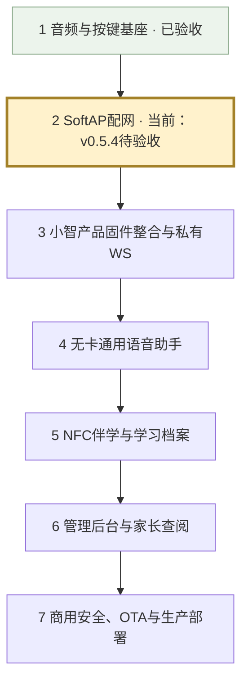

# stubuddy 开发全景与当前位置

当前日期：2026-11-01。当前固件：独立诊断工程v0.5.4，SoftAP BUG修复待真机验收。
已提交基线：6f2b3ba。配网功能尚未建立Git检查点。
这里的大阶段用于看全景；每个大阶段继续拆成小检查点，每次只实现一个可独立验收的特性。

| 大阶段 | 目标与分步验收 | 状态 |
| --- | --- | --- |
| 1 音频/按键/LED | 扬声器提示音、PDM录音回放、PTT消抖、60秒自动回放、待机灯灭/录放常亮 | 用户实测通过，已提交 |
| 2 SoftAP配网 | 开放热点、手机配网页、历史列表、配置保存、正常开机重连、人工配网等待、呼吸/错误灯效 | 当前修复中，v0.5.4待验收与提交 |
| 3 产品固件与私有WS | 先建立xiaozhi专用纯音频板型，迁移已验证引脚/交互；再分步复用Opus和网络流控，连接私有WS测试服务 | 未开始 |
| 4 无卡通用助手 | 先PTT完整ASR→LLM→TTS，再端云VAD/全双工打断；分别验收音量工具、独立闹钟音量和定时提醒 | 未开始 |
| 5 NFC伴学 | 先读卡/防抖/移除回无卡模式，再技能模板/音频自动交麦/RAG/关卡激励；最后一卡一档与通关即存 | 未开始 |
| 6 中台与家长端 | 逐项验收技能与卡片编排、模型安全参数热更、设备账户/激活、家长学习记录与每日03:00归档 | 未开始 |
| 7 商用发布 | 分别实现设备鉴权/签名/限流、OTA校验与回滚、WS网关扩展/监控/故障恢复、生产压测 | 未开始 |

## 当前做到哪里

- 本地硬件音频链已在真机验证，当前工程能够按住录音、松开回放及一分钟自动回放。
- SoftAP已实现并做过多轮真机反馈，最新两项BUG和列表易用性调整仍等待本版确认。
- 尚在独立speaker-selftest诊断工程，并未完成xiaozhi产品固件板型整合。
- 没有完成ASR、模型、TTS云端对话、全双工、MCP、NFC、CMS、OTA或商用部署；不能把能联网视为产品完成。
- 当前保留用户已测试的右声道/5V供电条件；量产电气、供电/静音/充电及低电量的硬件验证另外安排。

## 当前下一步

1. 按BUGFIX-VALIDATION-v0.5.4.md验收两项BUG与列表交互。
2. 通过后在本地提交本配网检查点；不能带着未记录的大改动继续跨阶段。
3. 先讨论并确认检查点3.1，再修改xiaozhi产品固件。

## 检查点3.1：专用纯音频板型（拟定，尚未实施）

工作流先确认：相同硬件引脚和声道、GPIO15上电配网/日常PTT、LED状态优先级、配网时阻止意外连接、普通开机保存网络重连。
实现前核对原仓库结构和ESP-IDF6.1兼容性，确认哪些现有Opus/WS/音频基础设施直接复用。
只建立stubuddy专用板型并移植已验收的最小本地音频/按键/灯光能力，不同时接模型或NFC。
验收：专用配置可编译烧录，真机本地音频交互正常，构建依赖不引入屏幕/摄像头/BLE无用模块。

后续检查点3.2再接入已验收SoftAP；3.3单独验证Opus编码；3.4用私有WS回声服务验证音频上下行和断线恢复。
具体拆分以原仓库实际接口和讨论结果为准。每个检查点都按讨论→确认→实现→给命令→用户实测→Git提交执行。
生产并发、延迟、可用性与成本目标在部署前结合服务器规格确定，不在未压测时宣称商用达标。
