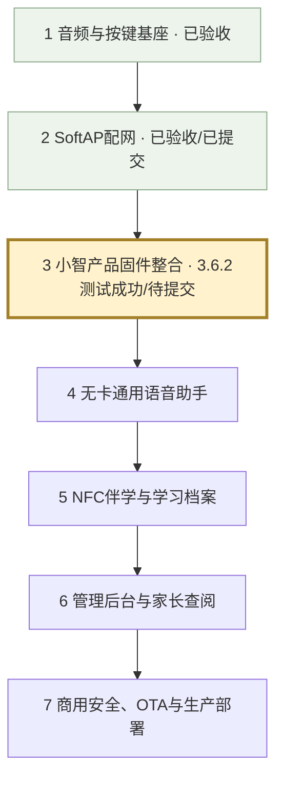

# stubuddy 开发全景与当前位置

当前日期：2026-11-03。当前检查点：3.6.2，私有ECS/WSS已部署，用户反馈测试成功，待建立Git检查点。3.6.1已通过用户真机验收并提交5df51a4。
配网阶段已验收并提交为b22dc91；硬件音频基线为6f2b3ba。
这里的大阶段用于看全景；每个大阶段继续拆成小检查点，每次只实现一个可独立验收的特性。

| 大阶段 | 目标与分步验收 | 状态 |
| --- | --- | --- |
| 1 音频/按键/LED | 扬声器提示音、PDM录音回放、PTT消抖、60秒自动回放、待机灯灭/录放常亮 | 用户实测通过，已提交 |
| 2 SoftAP配网 | 开放热点、手机配网页、历史列表、配置保存、正常开机重连、人工配网等待、呼吸/错误灯效 | 用户实测通过，已提交b22dc91 |
| 3 产品固件与私有WS | 先在小智主工程建立专用板型并验证一次提示音，再逐项迁移交互、配网、Opus、私有WS | 3.1～3.6.1已验收并提交；3.6.2私有ECS/WSS用户反馈测试成功，待Git提交 |
| 4 无卡通用助手 | 先PTT完整ASR→LLM→TTS，再端云VAD/全双工打断；分别验收音量工具、独立闹钟音量和定时提醒 | 未开始 |
| 5 NFC伴学 | 先读卡/防抖/移除回无卡模式，再技能模板/音频自动交麦/RAG/关卡激励；最后一卡一档与通关即存 | 未开始 |
| 6 中台与家长端 | 逐项验收技能与卡片编排、模型安全参数热更、设备账户/激活、家长学习记录与每日03:00归档 | 未开始 |
| 7 商用发布 | 分别实现设备鉴权/签名/限流、OTA校验与回滚、WS网关扩展/监控/故障恢复、生产压测 | 未开始 |

## 当前做到哪里

- 独立speaker-selftest的音频、按键、灯光和SoftAP已由用户验收，已提交b22dc91。
- 3.1已在小智主工程创建stubuddy专用板型，三次上电验收通过，已提交dac5504。
- 3.2全部按键流程与连续10轮真机验收通过，结束无杂音，已提交e6e553c。
- 3.3灯效、60秒自动回放、松键保护及连续10轮验收通过，结束无杂音，已提交e8ec267。
- 3.4新增wifi-ptt变体，迁移免密码热点、极简门户、五条成功历史与原NVS格式；强制配网在提示音前锁定，用户真机验收通过。
- 3.4.1补验：门户就绪后放行DHCP、首次探测302跳转、页面等待进度、成功3秒关闭热点、失败下降三音并保留错误提示。
- 3.4.1配网与3.4.2按键打断/接续录音、首字、60秒灭灯交接和连续十轮录放均已真机验收通过，无杂音，已提交f5675ba。
- 3.5新增wifi-opus-ptt独立变体：边录音边按60ms编码，停止后补齐末帧/编解码延迟，解码后按真实采样数回放；保留3.4 PCM基线供回退。2026-11-03用户确认Opus自检、录放首尾、采样数一致、errors=0、60秒自动回放、按键打断、配网/断网恢复及连续十轮均通过，结束无杂音。
- 网络等待暂停新录音，已开始的一轮完整结束；恢复后必须先松键再重新按下。网络提示音由同一音频任务串行播放。
- 3.5已提交a49b3ff。3.6.1新增ws-echo固件与Windows轻量回声服务，实时逐帧上传，接收完整并校验后解码回放；等待/回放可取消并接续PTT。服务器内存暂存，结束或断线清理。
- 2026-11-03用户确认3.6.1真机验收通过：局域网回声正常，帧数、CRC和采样数一致，errors=0；60秒自动回放、等待/回放时打断、服务重启、断网恢复及连续十轮均正常，无异常、无杂音。
- 3.6.1已提交5df51a4。3.6.2新增独立wss-echo变体：SNTP校时、SDK根证书包与严格目标/有效期校验，独立云端Token；提供Ubuntu部署前检查、Nginx入口、systemd服务和短期IP证书自动续期。本机编译、配置隔离及TLS正反例通过。
- 2026-11-03：用户反馈ECS部署、证书签发/续期演练和电脑公网WSS自测PASS；开发板通过USB自动下载完整写入并校验成功，随后反馈“测试成功”，待Git提交。实物只有GPIO15主按键，没有BOOT/RST实体按键，相关操作文档已修正。
- 配网呼吸灯和错误闪烁在3.4实测；模型等待灯效接入模型时再测。
- ASR/模型/TTS云端对话、全双工、MCP、NFC、CMS、OTA和商用部署仍在后续阶段。

## 当前下一步

1. 将3.6.2固件、云端部署工具、测试及文档提交Git；私有Token、云端配置和部署包保持忽略。
2. Git检查点完成后，再讨论正式ASR/LLM/TTS会话的功能流程，确认后实现；局域网回退基线继续保留。
3. 部署、烧录、复测与回退步骤继续保存在 [3.6.2验收说明](../../../xiaozhi-esp32-main/xiaozhi-esp32-main/main/boards/stubuddy-s3-n16r8/WSS-ECHO-VALIDATION.md)。

## 第3阶段小检查点

| 检查点 | 内容 | 验收 |
| --- | --- | --- |
| 3.1 | 专用板型、启动、一次提示音 | 三次上电均清楚且安静结束 |
| 3.2 | 迁移PDM采集与PTT录放 | 消抖、松开回放、60秒自动回放 |
| 3.3 | 迁移状态LED | 待机灭灯、录放常亮、等待/错误优先级 |
| 3.4 | 迁移已验收SoftAP | 首次确认、历史重连、人工配网保持等待 |
| 3.5 | Opus编解码 | 编解码回放清楚，资源稳定 |
| 3.6 | 私有WS回声通道 | 3.6.1局域网往返/打断/恢复；提交后再做3.6.2私有ECS/WSS |

正式AI播报阶段必须验收：按下取消旧回复并清除端侧音频队列、继续按住收音/松开发送，以及回合标识过滤云端晚到的旧音频。

每个检查点都按讨论→确认→实现→给命令→用户实测→Git提交执行。
生产并发、延迟、可用性和成本目标在部署前结合服务器规格确定，不在未压测时宣称商用达标。
